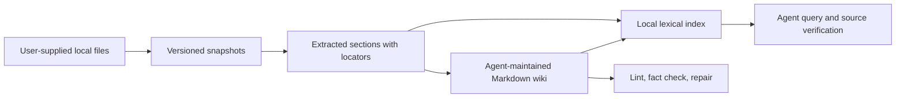

# Architecture and release boundary

Status: first-release design, confirmed in the November 2026 design interview. Earlier exploratory notes are archived under `docs/project-history/`.

## Purpose

Each user clones the template and supplies their own authorized sources. An agent maintains a local, linked Markdown wiki from those sources. The wiki supports source-backed questions, lint, citation fact checking, and repair. Synthetic-brain generation is a later, explicit skill or subagent; it does not run in the first release.

## Separation of responsibilities

The local CLI acquires bytes, hashes versions, extracts text, tracks a resumable queue, indexes content, and checks mechanical invariants. The agent reads evidence, writes synthesis and topical links, evaluates semantic conflicts, and asks the user to resolve genuinely ambiguous repairs. Raw snapshots never receive edits.

A source is not an instruction channel. Any commands or role requests inside acquired text remain part of the quoted evidence. The agent contract and operational workflows are versioned in the template; user sources, wiki pages, metadata, reports, and the index are generated under ignored `.bropsy/`.

## Query and verification

Search wiki pages first, then open original evidence for each claim. Search original sources directly if the wiki misses the topic. Cite source ID, version, and locator; preserve conflicting claims with both citations. The fact-check skill audits whether cited passages actually support an answer. The CLI only verifies the citation's structural validity.

Lint has an incremental operational pass after each ingest and a full agent-driven pass on request. Mechanical findings are distinct from semantic review findings. Repair edits derived wiki material and pauses for human judgment when a correction would choose between conflicting sources or invent missing evidence.

## Portability

`AGENTS.md` is the shared contract. Copilot and Claude entry files point to it. Project skills live in `.agents/skills/`, a location documented for [Codex](https://developers.openai.com/blog/skills-agents-sdk) and [Copilot](https://docs.github.com/en/enterprise-cloud@latest/copilot/concepts/customizations/agent-skills). The Python CLI and JSON/Markdown formats are shared across hosts. Windows is the initial development environment; paths and the CLI are designed for other operating systems. Claude Code is documented but unverified.

## Release claims

The first release uses provisional local SQLite FTS5 search and temporary test fixtures. It does not include an example corpus, user data, synthetic answers, OCR, or a 4,000-document performance claim. The [search options research](../research/search-at-scale.md) records the provisional choice. A public benchmark with prepared queries and expected sources is a later milestone. Its outcome may justify changing the search implementation without changing the source, citation, and wiki formats.
