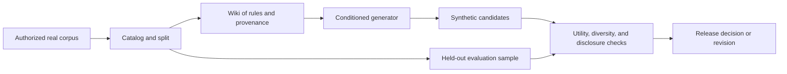

# Synthetic Brain

## Working definition

A **synthetic brain** approximates selected observable behaviors of a human or organizational source to generate new examples under explicit constraints. Fidelity is measured against a task and held-out data. “Clone” is a metaphor; it does not imply identity, consciousness, or general equivalence.

## Two distinct outcomes

1. **Behavioral simulation**: new texts, answers, or decisions consistent with observed behavior. Evaluate task adherence, diversity, and generalization to unseen scenarios.
2. **Statistical synthetic data**: new records preserving useful relationships in a corpus. Evaluate downstream utility, distributional fidelity, and disclosure risk.

The second outcome does not follow automatically from the first. Data type and purpose determine the method.

## Proposed pipeline

The wiki makes rules and provenance explicit. Prompting, model adaptation, and statistical synthesis are candidate generation methods to test.

## Minimum protocol

- State an observable task, such as: “Given conditions X, produce decision Y with rationale Z.”
- Split by entity or time when a shared history could leak into evaluation.
- Compare with a simple baseline on unseen examples.
- Check exact and near duplicates and assess record or attribute disclosure.
- Report rare cases and subgroups as well as averages.
- Track real and generated data separately across iterations.

## Open questions

1. Does the “brain” represent a person, team, decision process, or data distribution?
2. What are the format, volume, license, consent, and sensitivity of the real data?
3. Are the required outputs texts, conversations, decisions, or tabular records?
4. Which downstream task measures utility, and who can access the output?

## Initial evidence

- [Karpathy's Gist](https://gist.github.com/karpathy/442a6bf555914893e9891c11519de94f) proposes a persistent wiki with sources, an index, and a log.
- [NIST SP 800-226](https://nvlpubs.nist.gov/nistpubs/SpecialPublications/NIST.SP.800-226.pdf) distinguishes formal privacy protection from informal synthesis claims.
- The [NIST Synthetic Data Test Drive](https://pages.nist.gov/HLG-MOS_Synthetic_Data_Test_Drive/guide.html) evaluates utility and privacy for specific uses.

This is a research proposal, not an experimental result. See the [research note](../research/synthetic-brain.md).
